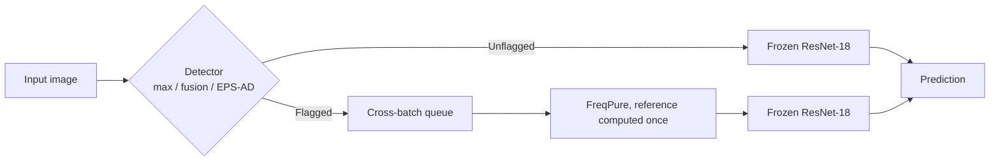

# Learned Fusion Detection and Selective Purification for Adversarial Images

An empirical study of input-side defenses for a clean-trained CIFAR-10 classifier. Following the [final project proposal](docs/final-project-proposal.pdf), the project is a controlled test of whether **detection gains translate into useful accuracy after accounting for latency and attack adaptation**.

This repository is the workspace for Team 5's CSCI 8000 final project at the University of Georgia. The [experimental protocol](docs/experimental-protocol.md) records the data split, components, attacks, and metrics; the [results report](docs/progress-report.md) contains every measured number.

**Current state (November 18, 2026):** All proposal experiments have been run on the official CIFAR-10 test set: the 10,000-image matched evaluation (clean, FGSM, PGD at 4/255 and 8/255), C&W L2 on a fixed 1,000-image subset, a white-box adaptive evaluation on a fixed 1,000-image subset, and a serving-cost benchmark. Nothing in the test-set runs was used for model selection.

## Design

Every variant uses the same frozen ResNet-18 and the same purifier; only the routing differs.

| Variant | Detector | Purified inputs |
|---|---|---|
| `none` | — | none |
| `max` | Feature squeezing, max-disagreement rule (Xu et al., NDSS 2018) | flagged |
| `fusion` | Feature squeezing, logistic-regression fusion of the three disagreements and the prediction margin | flagged |
| `epsad` | EPS-AD (Zhang et al., ICML 2023): expected perturbation score + deep-kernel MMD | flagged |
| `always` | — | all |

All three detectors are calibrated to a 5% false-positive rate on clean validation images. The squeezing detectors are the weak detectors of the study and EPS-AD the strong one, so the comparison isolates the effect of detection quality on end-to-end accuracy. `max` and `fusion` are the proposal's baseline and learned detector; EPS-AD was added because the two squeezing detectors are too close in quality to answer the research question on their own. The fusion detector is trained on FGSM and PGD at 4/255 as in the proposal; EPS-AD uses its paper's FGSM / FGSM-L2 examples at 1/255. FreqPure and the diffusion model are used as released, without adversarial training; all attacks are our own PyTorch implementations.

The purifier is FreqPure (ICML 2025) on the public `google/ddpm-cifar10-32` diffusion model: diffuse to t = 999, run 100 DDPM steps, and at each step replace the low-frequency amplitude of the clean estimate and constrain its low-frequency phase using a reference image. The released code redraws the reference (input diffused to t = 50, then denoised in one step) at every step, for 200 UNet calls per image. We compute the reference **once** (101 UNet calls); the [results report](docs/progress-report.md#reference-ablation-once-versus-per-step) shows this halves the cost with no measured loss under transfer or adaptive attacks.



## Main findings

On the official test set (details and caveats in the [results report](docs/progress-report.md)):

1. **Learned fusion does not consistently beat the max rule.** At the same 5% false-positive rate it is better on FGSM and C&W but worse on PGD (PGD-8 accuracy 25.0% vs 40.1%); both squeezing detectors miss most attacks.
2. **Under transfer attacks, better detection does translate into accuracy.** Raising detector AUROC from 0.76-0.87 (squeezing) to 1.00 (EPS-AD) lifts PGD-8 accuracy from 25.0-40.1% to 80.0%, matching always-on purification (80.3%) while keeping clean accuracy at 91.4% instead of 86.3%.
3. **Selective routing improves throughput only with cross-batch queueing.** At 0-25% attacked traffic, queued EPS-AD routing serves images 2.0-3.9× faster than always-on purification; purifying flagged rows inside each batch gives almost no gain. Above about 75% attacked traffic the detector is pure overhead.
4. **The detection gain does not survive an unseen attack or an adaptive attacker.** EPS-AD detects only 56.8% of C&W L2 examples (routed accuracy 54.1% vs 85.3% for always-on purification). Under white-box adaptive attacks, worst-case accuracy is 0.0% for max and fusion routing, 4.7% for EPS-AD routing, and 23.8% for always-on purification, because routing gives the attacker a way around the purifier.
5. **One-step surrogates overstate diffusion-purification robustness.** Attacking FreqPure through a one-step surrogate leaves 84.0% accuracy; a ten-step surrogate brings it to 31.6% on the same images.

## Reproduce the study

Use Python 3.10 or newer and a CUDA GPU. TorchVision downloads CIFAR-10 into the ignored `data/` directory; alternatively, `scripts/download_cifar10_parquet.sh data` fetches the pinned University of Toronto Hugging Face mirror after installing `.[dev,hf-data]`. The default seed `2026` splits the 50,000 training images into 45,000 training and 5,000 validation images. The official test set is used only for final evaluation. The diffusion model is the public `google/ddpm-cifar10-32` checkpoint, stored under `checkpoints/ddpm-cifar10-32`.

```bash
python -m venv .venv
source .venv/bin/activate
python -m pip install -e '.[dev]'
adversarial-image-defense train-classifier --epochs 20
adversarial-image-defense fit-detector --classifier checkpoints/classifier.pt
adversarial-image-defense fit-epsad --classifier checkpoints/classifier.pt
adversarial-image-defense ablate-squeezers --feature-cache checkpoints/detector.features.npz
adversarial-image-defense evaluate --epsad checkpoints/epsad.pt \
  --output runs/final-freqpure/evaluation.json
adversarial-image-defense adaptive-attack --split test --examples 1000 --batch-size 125 \
  --output runs/final-freqpure/adaptive.json
adversarial-image-defense benchmark-latency --split test --examples 1024 \
  --output runs/final-freqpure/latency.json
pytest -q
```

`evaluate`, `adaptive-attack`, and `benchmark-latency` default to the once-reference FreqPure spec in [`configs/freqpure-ref-once.json`](configs/freqpure-ref-once.json); [`configs/freqpure.json`](configs/freqpure.json) is the released per-step reference. The validation-only reference ablation uses `probe-purifier` with each spec and `--adaptive-examples 256 --adaptive-surrogate-steps 10`; [`scripts/reference_variability.py`](scripts/reference_variability.py) measures how much the reference changes between random draws.

The measured outputs of these runs are committed under [`results/`](results): `results/final/` (test set) and `results/validation/` (design-time validation runs); `results/preliminary/` keeps the October classifier and squeezing-detector records. On an RTX 5090 the three final runs take about 25 minutes (latency), 80 minutes (evaluation), and 3 hours (adaptive). `--device auto` selects CUDA, then Apple MPS, then CPU. Checkpoints, data, and run output are ignored by Git. Validation-split runs (`--split validation`) are for integration checks and model selection only.

## Earlier design

The proposal's first purifier was a small residual autoencoder trained with reconstruction, classification, and identity losses (`train-purifier`). It recovered at most 69% attacked accuracy on validation while lowering clean accuracy to 80.5%, so it was replaced by FreqPure before any test-set evaluation; its validation results are kept in the [results report](docs/progress-report.md#superseded-autoencoder-purifier). The planned purifier-loss ablation applied to that trained autoencoder and is replaced by the FreqPure reference ablation.

## Limitations

All results are empirical, from one seed and one classifier; nothing here is certified robustness. The adaptive attacks are strong standard choices (Selective PGD with exact EPS-AD gradients, BPDA for squeezers, EOT-PGD through a ten-step FreqPure surrogate) but not a proof of a lower bound. JPEG squeezing runs on the CPU through libjpeg (0.09 ms per image; a GPU nvJPEG path was slower and changed the features). Latency depends on the GPU and the batch size.

## Team

Ruqing Liu, Yifan Zhou, and Xinliang Li.

## License

No license has been selected. Public visibility does not grant permission to reuse the code or project materials.
